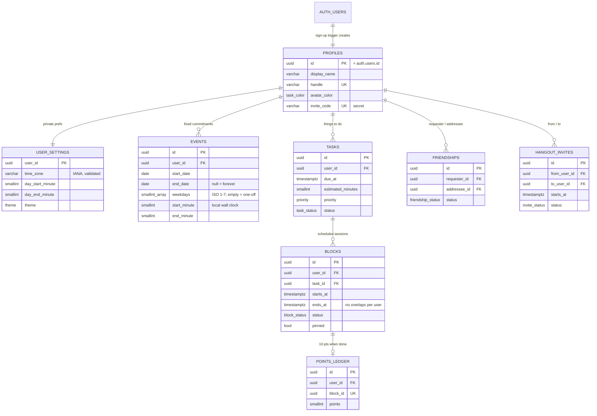

# Database

Postgres on [Supabase](https://supabase.com), schema managed with
[Prisma](https://www.prisma.io), and every table protected by row-level
security (RLS).

## Schema



| File | What it is |
| --- | --- |
| `prisma/schema.prisma` | Tables, columns, relations. Generates the typed client in `lib/generated/prisma` (on `npm install`). |
| `prisma/migrations/*/migration.sql` | The SQL that actually runs. Part A is generated by Prisma; Part B is hand-written: constraints, triggers, privileges, RLS policies, functions. |
| `lib/db/prisma.ts` | The server-only Prisma client (pooled connection). |
| `lib/db/rls.ts` | `prismaForUser()` / `asUser()`: run Prisma queries as a user so RLS applies. |
| `tests/unit/database.test.ts` | 20 security tests against real Postgres (PGlite). |
| `tests/unit/prisma-rls.test.ts` | Proves Prisma queries obey RLS. |

## Security model

- **RLS is on for every table**, so a row is invisible unless a policy allows it.
  Signed-out visitors (`anon`) can't read or call anything.
- **Private:** settings, events, tasks, blocks, points. Only the owner can read them.
- **Friends** can see your name and handle, and *busy times only* through
  `friend_busy_intervals()`, which returns start/end pairs and nothing else.
- **Points can't be faked:** the ledger is read-only for users;
  `complete_block()` awards 10 points once per block.
- **Column-level grants:** invite codes can't be read from the table (only
  your own, via `my_invite_code()`), and an invite's recipient can change
  only its status.
- **Integrity in the database:** no overlapping blocks (exclusion
  constraint), valid time zones (trigger), sane durations (CHECKs), one
  friendship per pair (unique index).

## Set up Supabase (about 10 minutes)

**Fastest (Windows):** after creating the project (step 1 below), run this from
the Planner folder. It asks for your database password (hidden), writes
`.env.local`, installs packages and creates the tables:

```powershell
git pull origin main
powershell -ExecutionPolicy Bypass -File scripts\setup-database.ps1
```

If your project or region differs, pass `-ProjectRef` and `-PoolerHost`
(both are in Supabase's **Connect** dialog). The steps below are the manual
version.


1. Create a free project at [supabase.com](https://supabase.com). Save the
   **database password** somewhere safe (a password manager).
2. In the project, click **Connect** (top bar) and copy two connection strings:
   - **Transaction pooler** (port **6543**) → `DATABASE_URL`
   - **Session pooler** (port **5432**) → `DIRECT_URL`

   Replace `[YOUR-PASSWORD]` in both with your database password.
3. Copy `.env.example` to `.env.local` and paste the two values in.
   **Never commit `.env.local` or paste these strings into a chat or issue.**
   They are full database credentials.
4. Create the tables:
   ```bash
   npm run db:migrate
   ```
   On Windows PowerShell use `npm.cmd run db:migrate`.
5. Check it worked: in Supabase, **Table Editor** shows 8 tables, each marked
   RLS enabled. Under **Authentication → Users**, add a test user; a matching
   row appears in `profiles` and `user_settings` automatically.

Useful commands: `npm run db:status` (which migrations have run) and
`npm run db:studio` (browse data in Prisma Studio).

## Accounts (Supabase Auth)

The app uses Supabase Auth for sign-up and sign-in. Without the two public
values below it runs in **demo mode** (no accounts, sample data only).

1. **Keys:** in Supabase, open **Project Settings → API Keys** and copy the
   **publishable key** (`sb_publishable_…`). Then either rerun the setup script
   with `-SkipMigrate` (it asks for the key), or add to `.env.local`:
   ```
   NEXT_PUBLIC_SUPABASE_URL="https://YOUR-PROJECT-REF.supabase.co"
   NEXT_PUBLIC_SUPABASE_PUBLISHABLE_KEY="sb_publishable_..."
   ```
   Both are public by design (they ship to the browser). Never put the
   **secret** key in a `NEXT_PUBLIC_` variable.
2. **Where email links may send people:** **Authentication → URL
   Configuration**: set **Site URL** to `http://localhost:3002` and add
   `http://localhost:3002/**` under **Redirect URLs** (add your Vercel URL
   too when you deploy).
3. **Email confirmation:** on by default, so new users get a "confirm your
   email" link before they can sign in. Supabase's built-in email service is
   rate-limited (a few emails per hour), which is fine for testing. To
   test quickly, you can turn **Confirm email** off under
   **Authentication → Sign In / Providers → Email**.
4. Restart `npm run dev`, then sign up at http://localhost:3002.

How it fits together:

| Piece | Job |
| --- | --- |
| `middleware.ts` | Refreshes the session cookie on every request and applies `routeFor()` (signed-out → `/`, not onboarded → `/onboarding`). |
| `lib/auth/routing.ts` | The access rules, as a pure function with unit tests. |
| `app/actions/auth.ts`, `app/actions/onboarding.ts` | Server actions: validate with zod again, call Supabase, return friendly errors. |
| `app/auth/callback/route.ts` | Where email links land; exchanges the one-time code for a session. |
| `lib/auth/session.ts` | `getAccount()`: the verified user (`getClaims()`), for Server Components. |

## Changing the schema later

1. Edit `prisma/schema.prisma`.
2. Generate the SQL for just the difference against your live database:
   ```bash
   mkdir prisma/migrations/20261101000000_add_something
   npx prisma migrate diff --from-config-datasource --to-schema prisma/schema.prisma --script > prisma/migrations/20261101000000_add_something/migration.sql
   ```
3. Add RLS for any new table at the end of that file: `enable row level
   security`, grants, and policies. A table without policies is invisible;
   a table without RLS is wide open.
4. Add tests in `tests/unit/database.test.ts`, run `npm test`, then
   `npm run db:migrate`.

Why not `prisma migrate dev`? It replays migrations into a temporary "shadow"
database, and a plain shadow database doesn't have Supabase's `auth` schema,
so the first migration fails there. Diffing against the real database avoids that.
