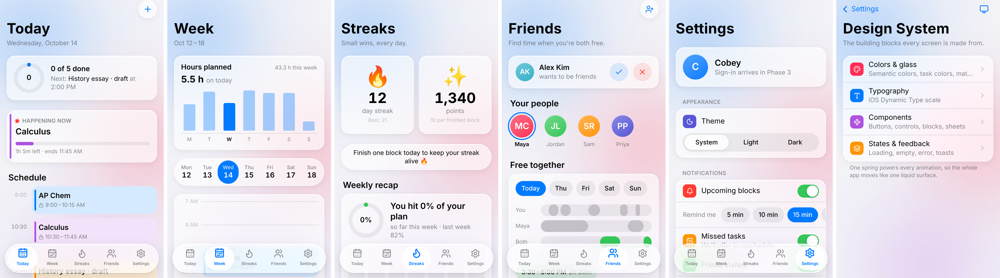
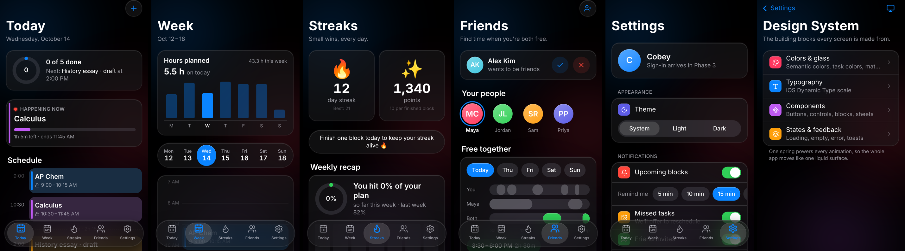

# Auto-Planner

Tell it what you need to do, and it plans your week. A mobile-first schedule
app for teens and young adults, with a native iOS "liquid glass" feel.

> Status: **Phases 1–3 complete** (design system; database with row-level
> security; real accounts and onboarding), plus every screen designed with
> sample data. Saving your schedule and the auto-planner come next.
> What each phase taught is in [LEARNING.md](LEARNING.md).




## Screens

| Screen | What it does |
| --- | --- |
| **Sign up / Log in** (`/`) | Create an account (name, @username with a live "available / taken" check, email, password) or log in with your email or username: validated on client and server (zod), password strength meter, email confirmation, password reset, and "Explore with sample data". Apple/Google buttons are placeholders. |
| **Onboarding** (`/onboarding`) | Name, optional profile photo (initials if skipped), time zone (auto-detected), optional city and state, then confetti. Planning is 24/7, so there are no hours to pick. |
| **Today** | Only your own tasks for today. Empty day: "No tasks for today 😊". Otherwise a progress ring, "Happening now", and a timeline with free gaps. **+** adds a task (auto-placed in the first open time, or at a time you pick). Tap a block to complete or delete it. |
| **Week** | **+** to add tasks (one day, any date up to a year out, several picked days, or repeating: every day, weekdays, weekly or chosen weekdays), week navigation, hours planned per day (computed the same way as the grid, so they always match), and a 24-hour day grid with a "now" line. |
| **Streaks** | Starts at 0 streak / 0 points. 10 points per finished block, purple flame at a 10+ day streak, weekly recap from your real blocks, and 31 badges in six groups that start locked and unlock by rule. |
| **Friends** | No starter friends. Requests, hangout invites, your invite link, **free time together** (busy/free only, never event names), and "People you may know": friends of friends, then people in your city. |
| **Schedule Helper** (`/helper`) | Chat with Claude to plan: "gym at 5 every Monday, Thursday and Friday", "find 2 hours to study tomorrow", "move my next task to Friday". It uses the same rules as the buttons and can only touch your own schedule. Needs an account and `ANTHROPIC_API_KEY`; it will be a paid feature later (`lib/plans.ts`). |
| **Settings** | Edit profile (photo, name, city/state), theme, **email** notifications, week start, time zone, "Suggest me to others", sign out. |
| **Design system** (`/design`) | Split into Colors & glass, Typography, Components, and States & feedback. |

New accounts get a one-time tour of Today, Week, Streaks and Friends. Signed in, every screen reads and writes your Supabase database (see [DATABASE.md](DATABASE.md)). In demo mode (no Supabase keys) the same features run in the browser, starting empty.

## Run it

Requires Node.js 22.6 or newer.

```bash
npm install
npm run dev
```

Open http://localhost:3002 to see the sign-up screen, or go straight to http://localhost:3002/today. On Windows PowerShell, use
`npm.cmd` instead of `npm` if scripts are blocked.

## Checks

| Command | What it does |
| --- | --- |
| `npm run lint` | ESLint |
| `npm run typecheck` | TypeScript |
| `npm test` | Vitest unit tests: database security on real Postgres, auth rules and actions (143) |
| `npm run test:e2e` | Playwright end-to-end tests in a real browser, light and dark (20) |
| `npm run check` | Lint, typecheck, unit tests, then a production build |

Before the first `npm run test:e2e` on a new machine, download the test browser
once with `npx playwright install chromium`.

For local environment variables, copy `.env.example` to `.env.local`. Database and accounts setup: [DATABASE.md](DATABASE.md). Without Supabase keys the app runs in demo mode.

## Stack

Next.js 15 (App Router) · TypeScript · Tailwind CSS v4 · Motion · Vaul ·
zod · Supabase (Postgres, Auth) · Prisma 7 · Vitest · PGlite · Playwright.
Coming in later phases: Supabase Realtime, dnd-kit, the Claude API, and Capacitor.

## Layout

```
app/
  (tabs)/            route group: today, week, streaks, friends, settings
    layout.tsx       shared shell: planner state + floating tab bar
    template.tsx     page transition between tabs
  design/            design system hub + 4 sub-screens
  globals.css        design tokens, liquid glass utilities, background orbs
components/
  screens/           one file per tab
  planner/           Add Task and task-detail sheets
  design/            design-system sub-screens
  ui/                reusable components (glass cards, tab bar, chips, …)
prisma/
  schema.prisma      tables and relations
  migrations/        SQL that runs (generated tables + hand-written RLS)
middleware.ts        session refresh + who-may-see-which-page
app/actions/         server actions (auth, onboarding)
lib/
  auth/              routing rules, validation, friendly errors, session
  supabase/          Supabase clients (server) and config
  db/                Prisma client + run-as-user helpers for RLS
  planner/           types, sample data, client state, free-time math
  design/            tokens, the single `fluid` spring, entrance helper
  time.ts            time formatting and week math
  use-now.ts         the current time, safely (no hydration mismatch)
tests/
  unit/              Vitest
  db/                test database harness + Supabase stand-in
  e2e/               Playwright
```

## Roadmap

1. ✅ Project setup, design system
2. ✅ Database schema + Prisma + RLS
3. ✅ Auth + onboarding
4. Today and Week views with fixed events (UI ✅, real data next)
5. Tasks + auto-scheduling algorithm + unit tests
6. Drag-to-reschedule + swipe-to-complete
7. Natural-language input with Claude API
8. Streaks + weekly recap (UI ✅)
9. Friends + shared free time + realtime (UI ✅)
10. Notifications, settings, privacy/terms pages (Settings UI ✅)
11. PWA setup, testing, deploy to Vercel
12. Capacitor wrap for iOS/Android + store-launch checklist
